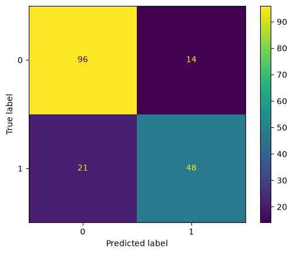
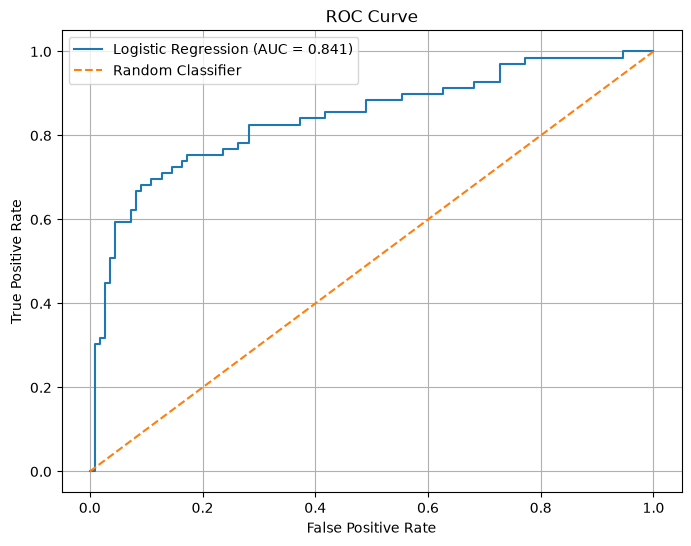
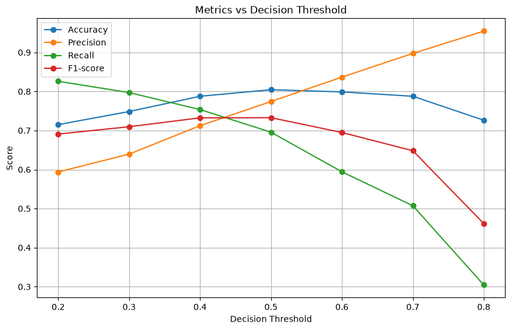

# Titanic — Prédire la survie des passagers


Projet de **classification binaire** avec scikit-learn sur le dataset Titanic de Kaggle : à partir des informations d'un passager (classe, sexe, âge, famille à bord, prix du billet, port d'embarquement, cabine), le modèle prédit s'il a survécu au naufrage.

Le but n'était pas seulement d'obtenir un bon score, mais de suivre une démarche rigoureuse de bout en bout : pipeline de préparation des données, comparaison de modèles en validation croisée, réglage des hyperparamètres, évaluation sur un jeu de test mis de côté, puis analyse des erreurs.

👉 Tout le code est dans le notebook [`titanic-modele.ipynb`](titanic-modele.ipynb).

---

## Résultats en bref

| Modèle | Validation croisée (10 plis) | Test (179 passagers) |
|---|:---:|:---:|
| Référence « toujours mort » | — | 61,5 % |
| Forêt aléatoire par défaut | 80,8 % | 81,0 % |
| **Forêt aléatoire réglée** (modèle retenu) | **83,4 %** | 76,0 % |
| Régression logistique réglée | 79,5 % | 80,4 % |

- **Tous les modèles battent nettement la référence** (prédire « mort » pour tout le monde) et tournent autour de 80 % d'accuracy.
- **Le modèle est choisi sur la validation croisée, pas sur le test** : c'est la forêt aléatoire réglée (83,4 %). Son score final sur le test est de 76,0 %.
- **L'écart de 7 points entre validation croisée et test** montre que le réglage était optimiste : le meilleur score parmi 84 combinaisons d'hyperparamètres surestime le vrai niveau du modèle.
- Sur le test, la régression logistique fait 80,4 %. Mais avec 179 passagers, **un passager vaut 0,56 point** : cet écart reste dans la marge d'incertitude, donc le choix du modèle n'est pas modifié d'après le test.

---

## Données

- **Source :** [Titanic – Machine Learning from Disaster](https://www.kaggle.com/competitions/titanic/data) (Kaggle), fichier `train.csv`.
- **891 passagers**, dont 38,4 % de survivants.
- **Valeurs manquantes :** `Age` (177), `Cabin` (687, soit 77 %), `Embarked` (2).

> Le fichier de données n'est pas inclus dans ce repo. Télécharge `train.csv` depuis Kaggle et place-le dans le dossier `data/`.

### Features utilisées

| Feature | Description | Traitement dans le pipeline |
|---|---|---|
| `Pclass` | Classe du billet (1, 2 ou 3) | utilisée telle quelle |
| `Sex` | Sexe | valeur la plus fréquente si manquante, puis one-hot |
| `Age` | Âge | médiane si manquant |
| `SibSp` | Nb de frères/sœurs/conjoint à bord | utilisée telle quelle |
| `Parch` | Nb de parents/enfants à bord | utilisée telle quelle |
| `Fare` | Prix du billet | médiane si manquant |
| `Embarked` | Port d'embarquement (C, Q, S) | valeur la plus fréquente si manquante, puis one-hot |
| `HasCabin` | **Feature créée** : 1 si le numéro de cabine est connu, 0 sinon | utilisée telle quelle |

`Cabin` est manquante à 77 % : plutôt que de l'imputer, j'en ai tiré une feature binaire `HasCabin`, car le simple fait d'avoir une cabine enregistrée est déjà une information utile.

---

## Démarche

1. **Feature engineering** : création de `HasCabin`.
2. **Découpage train / test 80 / 20 stratifié** (712 / 179 passagers) : la proportion de survivants est conservée dans les deux jeux (38,3 % et 38,5 %).
3. **Pipeline scikit-learn** qui enchaîne préparation et modèle. Les imputations sont apprises uniquement sur les données d'entraînement de chaque pli, ce qui évite toute fuite de données pendant la validation croisée.

   ```text
   Pipeline
   ├── ColumnTransformer
   │   ├── num   : Age, Fare                       → SimpleImputer(median)
   │   ├── cat   : Sex, Embarked                   → SimpleImputer(most_frequent) → OneHotEncoder
   │   └── other : Pclass, SibSp, Parch, HasCabin  → passthrough
   └── Classifier : RandomForestClassifier  |  LogisticRegression
   ```

4. **Réglage des hyperparamètres en deux temps :**
   - `RandomizedSearchCV` (5 plis) pour explorer largement l'espace des paramètres ;
   - `GridSearchCV` (10 plis) sur une grille resserrée autour du meilleur résultat.

   | Modèle | Recherche | Meilleurs paramètres |
   |---|---|---|
   | Forêt aléatoire | 30 combinaisons aléatoires → grille de 54 | `n_estimators=700`, `max_depth=10`, `min_samples_split=10`, `min_samples_leaf=1`, `max_features=None` |
   | Régression logistique | 20 combinaisons aléatoires → grille de 3 | `C=1.0`, `solver="lbfgs"`, `class_weight=None` |

5. **Évaluation finale sur le jeu de test**, une seule fois, avec le modèle retenu.
6. **Analyse des erreurs** : matrices de confusion, rapport de classification, courbe ROC et effet du seuil de décision.

---

## Analyse des erreurs

| Forêt aléatoire réglée | Régression logistique réglée |
|:---:|:---:|
|  |  |
| 26 survivants ratés sur 69 (rappel = 0,62) | 21 survivants ratés sur 69 (rappel = 0,70) |

*0 = mort, 1 = survivant.*

- **Les deux modèles font le même type d'erreur : ils ratent surtout des survivants.** Quand ils hésitent, ils penchent vers « mort », car 62 % des passagers sont morts.
- **Deux modèles très différents se trompent de la même façon** : la limite vient surtout des features disponibles, pas du choix du modèle.

### Courbe ROC et seuil de décision (régression logistique)

| Courbe ROC — AUC = 0,841 | Métriques selon le seuil |
|:---:|:---:|
|  |  |

| Seuil | Accuracy | Précision | Rappel | F1 |
|:---:|:---:|:---:|:---:|:---:|
| 0,2 | 0,715 | 0,594 | 0,826 | 0,691 |
| 0,3 | 0,749 | 0,640 | 0,797 | 0,710 |
| 0,4 | 0,788 | 0,712 | 0,754 | 0,732 |
| **0,5** (par défaut) | **0,804** | **0,774** | **0,696** | **0,733** |
| 0,6 | 0,799 | 0,837 | 0,594 | 0,695 |
| 0,7 | 0,788 | 0,897 | 0,507 | 0,648 |
| 0,8 | 0,726 | 0,955 | 0,304 | 0,462 |

Le seuil fixe le compromis entre précision et rappel : en le baissant à 0,4, on retrouve plus de survivants (rappel 0,70 → 0,75) pour un F1 quasiment identique, au prix d'une précision plus faible (0,77 → 0,71).

---

## Ce que j'ai appris

- **On compare et on choisit les modèles avec la validation croisée, jamais avec le test.**
- **L'accuracy seule cache le type d'erreurs** : la matrice de confusion montre que le modèle ne retrouve que 62 % des survivants.
- **Sur un petit dataset, des écarts de quelques points ne sont pas fiables.**
- **Un pipeline scikit-learn** garde la préparation des données et le modèle ensemble, ce qui rend la validation croisée et le réglage des hyperparamètres propres et reproductibles.

## Pistes d'amélioration

- Extraire le **titre** depuis le nom (Mr, Mrs, Miss, Master), très lié à l'âge et au sexe.
- Créer une feature **`FamilySize = SibSp + Parch + 1`**.
- Comparer ces nouvelles features en validation croisée, puis tester une seule fois le modèle final.
- Choisir le seuil de décision en validation croisée plutôt que sur le jeu de test.

---

## Lancer le projet

```bash
git clone https://github.com/zaki-123610/titanic-survival-prediction.git
cd titanic-survival-prediction

python -m venv .venv
# Windows :
.venv\Scripts\activate
# macOS / Linux :
source .venv/bin/activate

pip install -r requirements.txt
```

Télécharge ensuite `train.csv` depuis [Kaggle](https://www.kaggle.com/competitions/titanic/data), place-le dans `data/`, puis lance :

```bash
jupyter notebook titanic-modele.ipynb
```

## Structure du repo

```text
titanic-survival-prediction/
├── titanic-modele.ipynb   # notebook complet : préparation, modèles, réglage, évaluation
├── images/                # figures utilisées dans ce README
├── data/                  # placer train.csv ici (non versionné)
├── requirements.txt
└── README.md
```

## Stack

Python · pandas · NumPy · scikit-learn · Matplotlib · Jupyter
